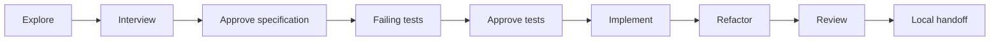

<div align="center">

# λ Haskell Harness

### Build Haskell with agents. Keep the decisions yours.

A local workspace for turning ideas into tested, reviewed patches.

[Get started](#open-your-workspace) · [User guide](docs/GUIDE.md) · [Model backends](BACKENDS.md) · [Contribute](docs/DEVELOPMENT.md)

</div>

---

Good software starts with a clear conversation. Haskell Harness helps you explore
an idea, sharpen the requirements, and work through the change with specialist
agents—all from a local website.

**You approve the specification. You approve the tests. You choose what happens next.**

## A workflow that respects your craft

- **Think before coding.** Explore the repository and compare approaches, or let an
  interviewer challenge your assumptions until the requirements are clear.
- **Tests lead the way.** Review failing Cabal tests before implementation begins.
  Strict builds, lint, and Nix checks accompany code changes.
- **Get a second opinion.** Dedicated Haskell and security reviewers examine the
  implementation after refactoring. An optional walkthrough helps you retain context.
- **Own every patch.** Work stays in isolated local worktrees, with saved conversations
  and small commits. Prepare a handoff when you're ready to publish.

Every phase is a choice. Stop after research, come back tomorrow, or take an idea
through the full workflow.



## Open your workspace

With Nix, run this from any directory:

```sh
nix run --refresh github:Devnull-org/haskell-harness -- --repo "/path/to/project"
```

Replace the path with your Git checkout, then open the printed local URL.
The command starts the local server; keep it running while using the website.

Choose **Explore** or **Plan a feature or fix**, select a base branch, and describe
what you have in mind. The harness checks your existing model logins and lets you
choose when more than one backend is available.

**Light, dark, or your system theme.** A familiar editor, visible conversation
history, and a stop button when you want to change direction.

Prefer running without Nix? See the [user guide](docs/GUIDE.md#without-nix).

## Your project. Your tools.

Built for Haskell projects, powered by LangGraph, and independent of any one model
provider. Use existing agent logins or connect your own backend. Save architecture
notes and invariants as shared project context for the team’s workflow.

The website runs locally. Model requests use your chosen provider. The harness
creates no pull requests and pushes no code automatically.

[Explore the workflow →](docs/GUIDE.md) · [Configure project checks →](docs/VALIDATION.md)
